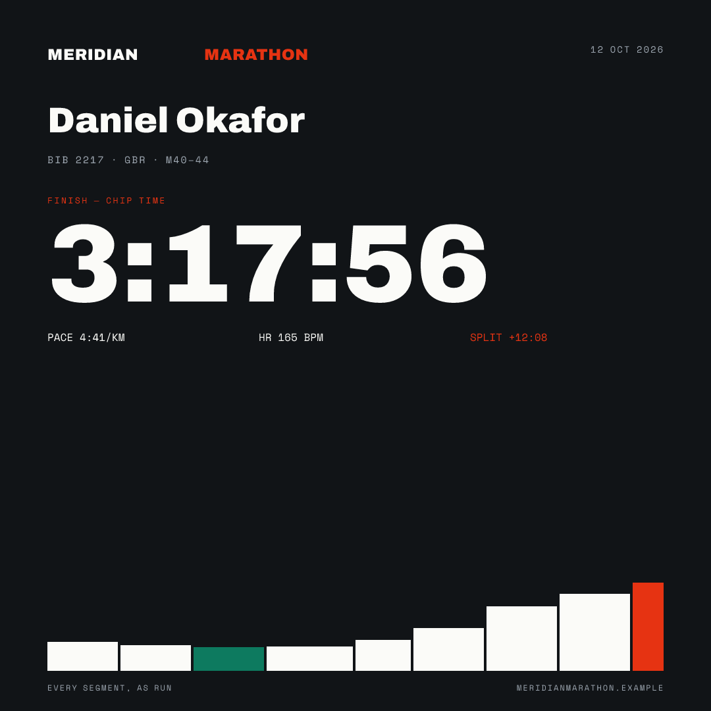
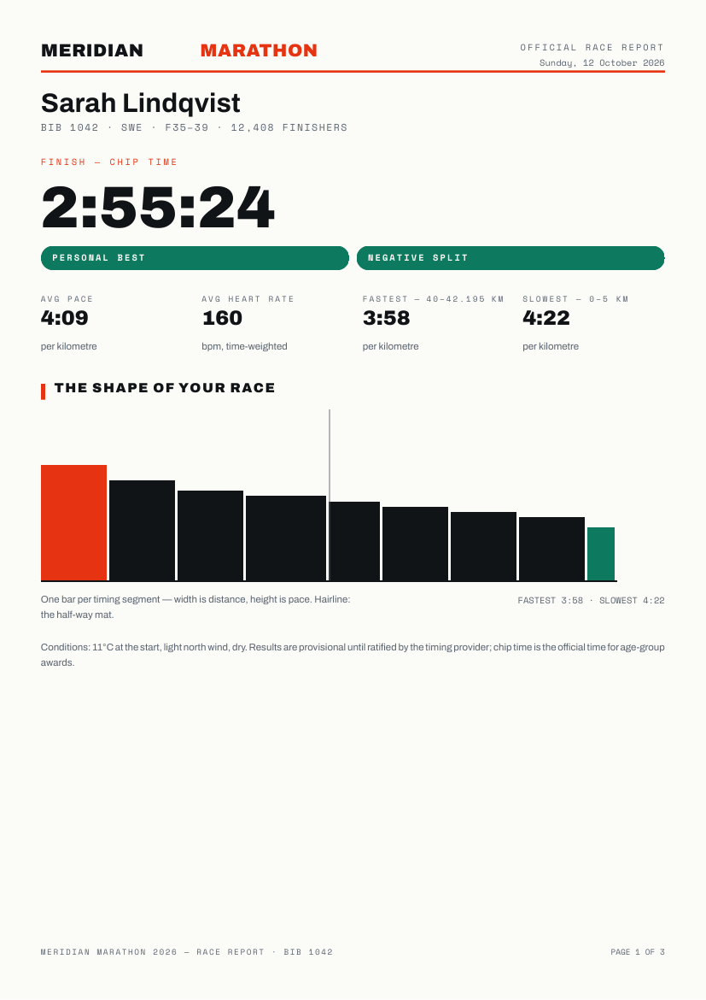
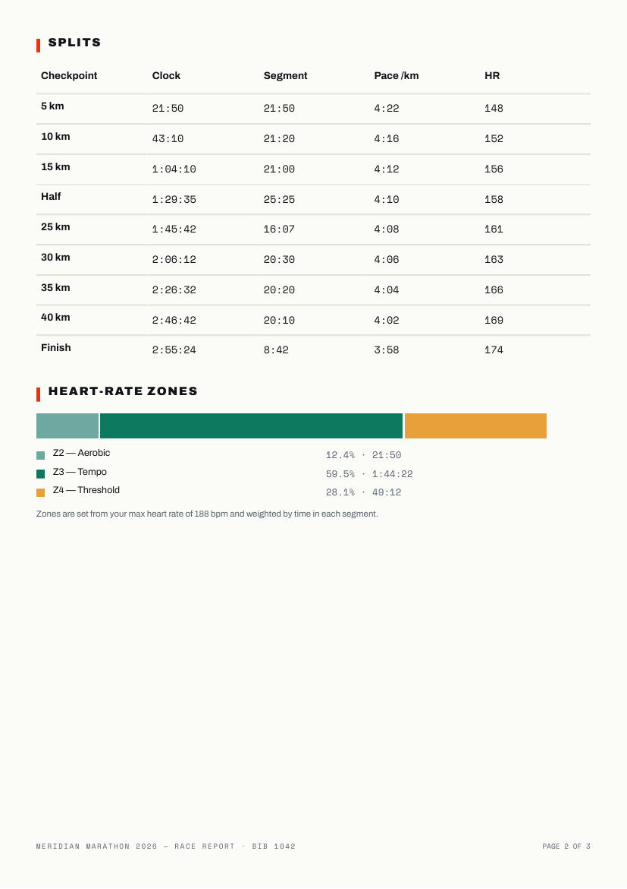
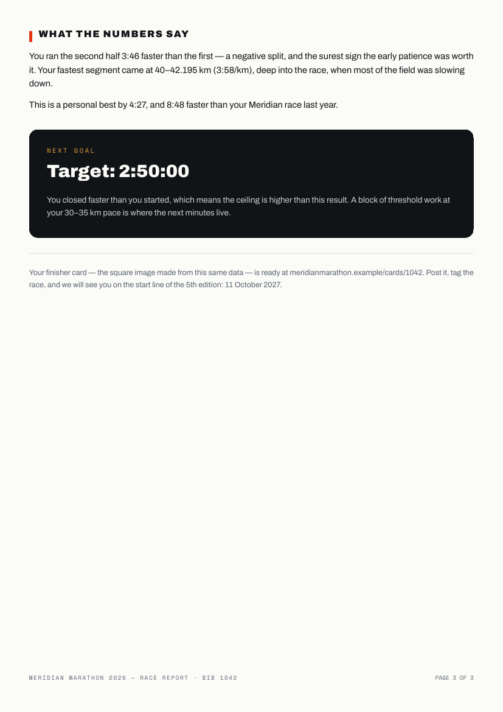
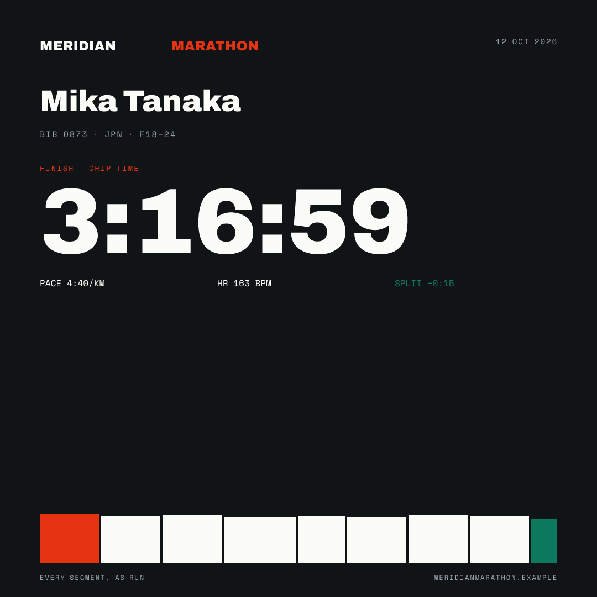

# Meridian Marathon — race reports by Hyper Elements

**A template that is also a program.** Feed this kit a timing provider's raw export — cumulative chip times and heart rate at each mat — and Hyper Elements computes everything else: segment paces, heart-rate zones, split stories, badges, a written analysis, and a next goal, then renders each athlete a three-page PDF race report and a square finisher card. No number in any output is hard-coded; change the data and the reports, charts and sentences change with it.

Built for the [Hyper Elements Template Challenge](https://github.com/hyper-elements/hyper-elements/discussions).



## Three athletes, three stories

`src/data.ts` holds one race (the fictional Meridian Marathon, 12 October 2026) and three athletes whose raw splits tell three different stories. The same two templates render all three:

| Athlete | The race they ran | What the kit derives |
| --- | --- | --- |
| Sarah Lindqvist, 2:55:24 | Patient start, faster every segment | **Personal best** + **negative split** badges, fastest segment at 40 km, a next-barrier goal of 2:50:00 |
| Daniel Okafor, 3:17:56 | Out at PB pace, hit the wall at 32 km | **Positive split** badge, an even-split equivalent (3:05:48) showing the fitness was there, a pacing-first goal |
| Mika Tanaka, 3:16:59 | Marathon debut, metronome even | **Debut** + **even split** badges, a 3%-improvement goal — and charts that stay flat, because her race was |



## The outputs

| Template | Root | Output | What it's for |
| --- | --- | --- | --- |
| [`src/report.tsx`](src/report.tsx) | `Document` A4, 3 pages | `out/report-<athlete>.pdf` (+ print HTML) | The official post-race report |
| [`src/card.tsx`](src/card.tsx) | `Canvas` 1080×1080 | `out/card-<athlete>.png` | The finisher card runners post |

Page one of the report is the result and the shape of the race; page two is the evidence — every split, every heart-rate zone; page three is what it means and what to chase next.




## How Hyper Elements is used

- **Props as the API.** Both templates take an `Athlete` and render entirely from it — the same component is a one-off template and a batch generator. `render.tsx` loops the start list, validates every report and card, and renders all six files (PDFs via `renderPdf()`, cards via `renderImage()`, fonts as bytes). Any error diagnostic stops the run.
- **Computed Svg charts.** The pace chart (`PaceChart`) draws one `Rect` per timing segment — width proportional to distance, height to pace — with the fastest segment in teal and the slowest in signal red, and a hairline at the half-way mat. The zone bar stacks time-in-zone as proportional `Rect`s. The charts are pictures *of the data*, drawn by the same numbers the tables print.
- **Conditional design.** Badges exist only when the data earns them: a PB badge appears only if the PB fell, a debut badge only for a first marathon. The analysis on page three is composed by `src/stats.ts` from the computed story — three athletes, three genuinely different texts.
- **Honest scales.** A metronome runner's segments differ by seconds; normalising a chart to that range would draw a flat race as a mountain range. `paceScale()` enforces a minimum 40 s/km span, so Tanaka's chart is as flat as her race actually was.
- **Document craft.** `PageFooter` with `PageNumber` on every page, a real `Table` for the splits, one `defineTheme` (Swiss timing-sheet minimalism: Archivo Black, Space Mono tabular data, signal red) shared by the report and the card.
- **Clean checks.** `npm run check` (the Hyper Elements CLI) reports **0 errors, 0 warnings**; `npm run typecheck` is clean. The templates take a default athlete so the CLI can render them standalone.



## Run it

```sh
npm install
npm run render    # validates everything, then generates all outputs into out/
npm run check     # hyper-elements check on both templates
npm run typecheck
```

**Run your own race:** replace the athletes in `src/data.ts` with your timing export — cumulative seconds and average heart rate at the nine standard mats — and re-run. Every report, chart, badge and sentence regenerates. (Splits at different checkpoints? Edit `checkpointsKm`; the stats engine is checkpoint-agnostic.)

## Structure

```
src/
  data.ts        the race + the raw timing export (the only input)
  stats.ts       the stats engine — every printed number is computed here
  theme.ts       the Meridian timing identity as one defineTheme
  components.tsx pace chart, zone bar, badges, stat blocks (shared)
  report.tsx     the three-page race report (Document root, athlete prop)
  card.tsx       the finisher share card (Canvas root, athlete prop)
  fonts.ts       font faces for the HTML output
render.tsx       validate + batch-render every athlete into out/
assets/fonts/    Archivo, Space Mono (WOFF for HTML, TTF for PDF/image)
preview/         the screenshots above
out/             generated reports and cards
```

## License

MIT — see [LICENSE](LICENSE). Fonts are Archivo and Space Mono (SIL Open Font License), via Fontsource.
